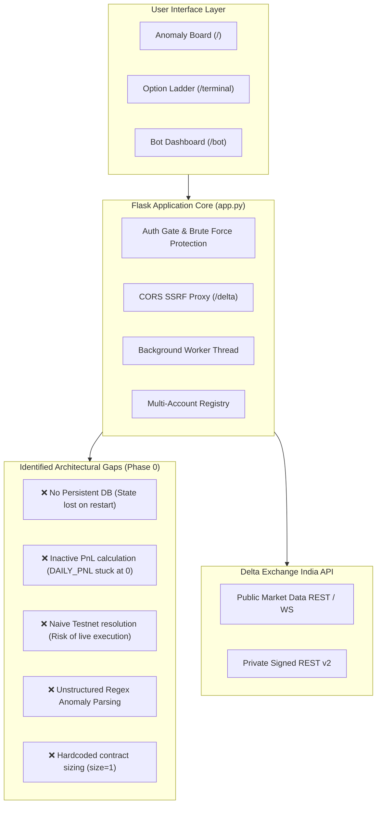
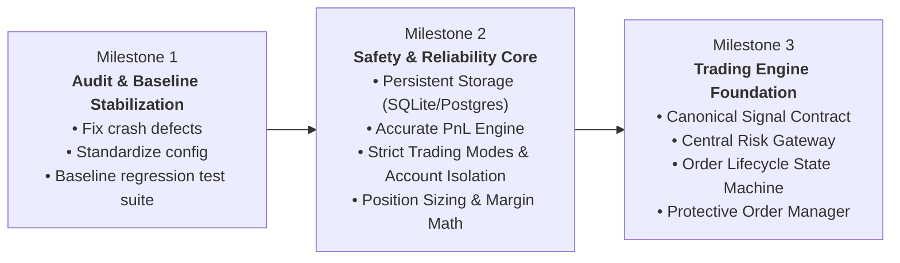

# Delta India Terminal — Master Implementation Plan & Phase 0 Audit

**Target System:** Multi-strategy, automated futures and options trading platform for Delta Exchange India  
**Baseline Repository:** `piyushrav1/delta-v01`  
**Execution Objective:** Safe, deterministic, auditable incremental upgrade preserving existing Flask UI/terminal while introducing institutional-grade risk and execution architecture.

---

## 1. Executive Summary & Baseline Architecture

The Delta India Terminal is currently a monolithic Flask application with two main web interfaces:
1. **Anomaly Board (`/`)**: A rule-based options mispricing scanner (`scanners/options_scanner.py`) with 7 anomaly strategies.
2. **Options Ladder Terminal (`/terminal`)**: An ODIN-style professional manual trading ladder supporting L2 depth, bracket orders, multi-account fan-out, and atomic order amendments.
3. **Auto-Trading Bot (`/bot`)**: An early background thread implementation attempting to parse anomaly alerts and place automated limit orders with native brackets.

---

## 2. Phase 0: File-by-File Source Audit & Defect Report

A meticulous review of the repository revealed the following defects, edge cases, and safety vulnerabilities that must be addressed prior to strategy development:

### 2.1 Critical Defects & Safety Vulnerabilities

| ID | Location | Defect Description | Severity | Impact |
|---|---|---|---|---|
| **DEF-01** | `app.py:430` | `scan_and_notify()` calls `datetime.datetime.now()` while line 4 imports `from datetime import datetime`. | **HIGH (Crash)** | Calling `/api/scan` crashes with `AttributeError`. |
| **DEF-02** | `app.py:53, 103, 198` | `DAILY_PNL` is initialized to `0.0` and never updated by fills, positions, or exchange sync. | **CRITICAL (Safety)** | `DAILY_PNL <= -MAX_DAILY_LOSS_USD` never triggers; daily loss limit protection is entirely non-functional. |
| **DEF-03** | `app.py:206-209, 615-619` | Testnet account selection logic (`'testnet' in label or aid == '2'`) falls back to `aid == '2'`. | **CRITICAL (Safety)** | If a user configures a second real account with label "Secondary", automated bot orders could route directly to LIVE exchange. |
| **DEF-04** | `app.py:118-122, 142` | `_execute_anomaly_trade` parses symbols from raw HTML text via regex `(C|P)-[A-Z]+-\d+-\d+` and hardcodes `size = 1`. | **HIGH (Execution)** | Fragile string parsing. Ignores contract multiplier, lot size, available margin, and underlying notional value. |
| **DEF-05** | `app.py:1483-1517` | `/api/terminal?type=ticker` and `chain` invoke `detector.delta_api.get_ticker()` and `get_options_chain()`, which do not exist on `DeltaAPI` in `options_scanner.py`. | **HIGH (Crash)** | Endpoints crash with `AttributeError` when requested by client. |
| **DEF-06** | `app.py:1432-1456` | `api_change_password()` references `global TERMINAL_PASSWORD`, but `TERMINAL_PASSWORD` is only read dynamically via `get_terminal_password()`. | **MEDIUM (Bug)** | Password change throws `UnboundLocalError` or `NameError` if not defined globally. |
| **DEF-07** | `app.py:61, 94, 185` | `ACTIVE_POSITIONS` is purely in-memory. | **HIGH (Reliability)** | Any restart of Flask or worker clears the set, causing duplicate position entries and exchange bracket rejection. |

### 2.2 Inventory of Existing Working Features (To Preserve)

- **HMAC-SHA256 Request Signing:** Correctly conforms to Delta v2 specifications (`METHOD + timestamp + path + query_string + body`).
- **Proxy SSRF Lock (`/delta`):** Restricted strictly to allowed Delta domains (`api.india.delta.exchange`, `cdn-ind.testnet.deltaex.org`, `api.deltaexchange.in`).
- **Multi-Account Order Fan-Out (`/api/orders/place-multi`):** ThreadPoolExecutor execution to place parallel orders across configured accounts with per-account latency reporting.
- **Native Atomic Amend (`/api/orders/amend`):** Uses PUT `/v2/orders` to adjust price and size without cancel-replace race conditions.
- **Password Throttle:** 5 failed attempts per IP enforces a 5-minute lockout.

---

## 3. Master Implementation Plan: Three-Milestone Strategy

---

### Milestone 1: Audit & Baseline Stabilization

**Goal:** Fix all immediate crash defects, secure configuration, and create unit/integration test baselines so current features function predictably.

#### Tasks:
1. **Fix Syntax & API Crashes:**
   - Resolve `datetime.datetime` import conflict in `app.py`.
   - Implement missing `get_ticker()` and `get_options_chain()` methods in `scanners/options_scanner.py` (or route them to `_delta_public`).
   - Fix `TERMINAL_PASSWORD` variable handling in `api_change_password`.
2. **Account Isolation & Strict Env Configuration:**
   - Eliminate fuzzy account resolution (`aid == '2'`).
   - Introduce explicit account environment tags: `TRADING_ENVIRONMENT=TESTNET|LIVE|PAPER`.
   - Hard-block automated executions if `TRADING_ENVIRONMENT != TESTNET` unless explicit `LIVE_AUTO_AUTHORIZED=true` flag is set.
3. **Automated Test Baseline Setup:**
   - Add `pytest` and `pytest-mock` to `requirements.txt`.
   - Create unit tests covering HMAC signing, proxy SSRF protection, order validation, and options parsing.
   - Run tests to establish zero regressions before structural refactoring.

#### Exit Criteria:
- All existing API endpoints return valid HTTP responses without unhandled 500 errors.
- Test suite passes 100%.

---

### Milestone 2: Safety, Reliability & State Persistence

**Goal:** Introduce persistent storage, live exchange-reconciled P&L, contract-aware position sizing, and circuit breakers.

#### Tasks:
1. **State Persistence Layer (`storage/`):**
   - Introduce SQLite (zero external setup for development) with seamless upgrade path to PostgreSQL.
   - Tables: `accounts`, `positions`, `orders`, `fills`, `pnl_snapshots`, `audit_events`.
   - Ensure local state recovers accurately across server restarts.
2. **Deterministic Daily P&L Engine:**
   - Compute Realized P&L from Delta fill history + Unrealized P&L from mark price and open positions.
   - Persist high-water mark and daily starting equity.
   - Daily loss limit circuit breaker: automatically halt new entries when realized + unrealized loss hits `MAX_DAILY_LOSS_USD`.
3. **Contract-Aware Position Sizing (`risk/position_sizing.py`):**
   - Query product specification (`contract_value`, `contract_unit_currency`, `tick_size`, `lot_size`).
   - Sizing formula:
     $$\text{Size (contracts)} = \min\left(\left\lfloor \frac{\text{Capital Allocation}}{\text{Entry Price} \times \text{Contract Multiplier}} \right\rfloor, \; \left\lfloor \frac{\text{Max Risk (USD)}}{\text{SL Distance} \times \text{Contract Multiplier}} \right\rfloor\right)$$
   - Validate against minimum order size and available wallet margin.
4. **Exchange Synchronization & Circuit Breakers:**
   - Scheduled periodic reconciliation: compare local database orders/positions against `GET /v2/positions/margined` and `GET /v2/orders`.
   - Emergency Circuit Breaker: if exchange connection fails or desync occurs, transition trading state to `PAUSED` and alert via Telegram.

#### Exit Criteria:
- Restarts do not reset daily loss limits or active position state.
- Automated sizing produces valid integer lots respecting lot size and risk caps.

---

### Milestone 3: Trading Engine Foundation

**Goal:** Establish canonical signal contracts, the central risk approval gateway, and an idempotent order execution engine.

#### Tasks:
1. **Structured Signal Contract (`trading/signal.py`):**
   - Refactor `options_scanner.py` and future strategies to return a standard `TradeSignal` dataclass:
     - `signal_id`, `strategy_name`, `symbol`, `direction` (BUY/SELL), `order_type`, `target_entry`, `stop_loss`, `take_profit`, `time_in_force`, `confidence`, `expiry_ts`.
   - Disallow strategies from issuing raw HTTP/API order requests.
2. **Central Risk Management Engine (`risk/risk_manager.py`):**
   - Central approval pipeline evaluating all incoming signals:
     1. Environment check (PAPER / TESTNET / LIVE)
     2. Market data freshness check (< 5 seconds old)
     3. Instrument trading status check
     4. Position limit & duplicate position check
     5. Margin and portfolio leverage check
     6. Daily/weekly drawdown limit check
   - Emit audit logs for both `APPROVED` and `REJECTED` decisions.
3. **Central Order Execution Gateway (`trading/execution_manager.py`):**
   - Owns the complete order state machine:
     $$\text{CREATED} \rightarrow \text{VALIDATED} \rightarrow \text{RISK\_APPROVED} \rightarrow \text{SUBMITTED} \rightarrow \text{ACKNOWLEDGED} \rightarrow \text{FILLED / CANCELLED}$$
   - Handles bracket orders, order timeouts, and idempotent order placement with client order IDs.
   - Verifies protective exit orders (SL/TP) are confirmed active by Delta before marking trade complete.

#### Exit Criteria:
- No strategy can place an order without passing the Central Risk Gateway.
- System operates in PAPER and TESTNET modes without any possibility of unverified live execution.

---

## 4. Work Breakdown & Phased Timeline

| Milestone | Phase | Scope | Target Files |
|---|---|---|---|
| **M1** | Phase 1.1 | Fix crash bugs & missing methods | `app.py`, `scanners/options_scanner.py` |
| **M1** | Phase 1.2 | Environment isolation & testnet guard | `app.py`, `.env.example` |
| **M1** | Phase 1.3 | Test suite baseline | `tests/test_api.py`, `tests/test_scanner.py` |
| **M2** | Phase 2.1 | SQLite persistence & migrations | `storage/database.py`, `storage/models.py` |
| **M2** | Phase 2.2 | Daily P&L tracking & loss cap enforcement | `risk/pnl_tracker.py`, `app.py` |
| **M2** | Phase 2.3 | Contract specifications & position sizing | `risk/position_sizing.py`, `exchange/delta_client.py` |
| **M3** | Phase 3.1 | Structured TradeSignal contract & registry | `trading/signal.py`, `strategies/base.py` |
| **M3** | Phase 3.2 | Central Risk Manager & Circuit Breakers | `risk/risk_manager.py`, `risk/circuit_breaker.py` |
| **M3** | Phase 3.3 | Authoritative Execution Gateway | `trading/execution_manager.py`, `trading/order_manager.py` |

---

## 5. Next Steps for Immediate Action

To begin Milestone 1 immediately, we will execute the following surgical improvements:
1. Fix the `datetime` syntax error and `DeltaAPI` method stubs in `app.py` and `scanners/options_scanner.py`.
2. Add explicit environment configurations and safety guards against accidental live routing.
3. Establish a pytest baseline to guarantee zero regressions.

