# DELTA INDIA TERMINAL — COMPLETE IMPLEMENTATION BLUEPRINT
**Document Version:** 1.0.0  
**Role:** Principal Software Architect, Quantitative Trading Systems Engineer, Risk Management Engineer  
**Status:** Planning & Architecture Baseline (No Code Modifications)  
**Target Platform:** Delta Exchange India (`api.india.delta.exchange` / `cdn-ind.testnet.deltaex.org`)

---

## 1. Executive Summary

The **Delta India Terminal** project aims to transition an existing monolithic Flask-based options ladder and anomaly scanner into an institutional-grade, multi-strategy, deterministic futures and options algorithmic trading platform. The architecture is engineered strictly as a **modular monolith** adhering to defense-in-depth principles: zero execution authority for raw strategies, fail-closed centralized risk validation, contract-aware position sizing, state persistence surviving all process restarts, and strict execution isolation across five mutually exclusive operating modes (**BACKTEST**, **PAPER**, **TESTNET**, **LIVE_MANUAL**, **LIVE_AUTO**).

This document serves as the master engineering blueprint governing all future development sessions in Claude Code. It covers **Phases 0 through 16**, defining every task, schema, interface contract, mathematical formula, risk gate, and failure scenario.

---

## 2. Existing System Assessment

### 2.1 Technology Stack & Architectural Profile
- **Runtime:** Python 3.10+ running Flask (synchronous WSGI development server).
- **Network / Transport:** `requests.Session` (thread-local pooling), raw REST polling (2s-15s), public WebSocket stubbing.
- **Frontend:** Jinja2 templates (`terminal.html`, `index.html`, `bot_dashboard.html`, `login.html`) utilizing vanilla ES6 JavaScript, HTML5 tables, and CSS flexbox.
- **Authentication & Security:** HMAC-SHA256 request signing for Delta v2 API; terminal password gate with IP-based brute-force throttle (5 attempts $\rightarrow$ 5 min lock); SSRF-locked proxy at `/delta`.
- **Threading Model:** Single daemon thread `background_scanner_worker` controlled by `threading.Event()` (`SCAN_ACTIVE`), triggering periodic anomaly checks and order executions.

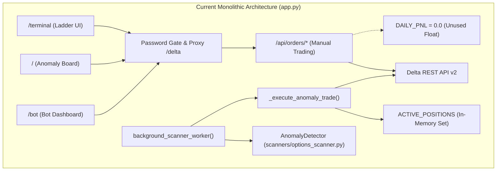

---

## 3. Verified Defects and Existing Capabilities

### 3.1 Verified Defects Matrix

| Defect ID | Category | Location | Source Code Evidence | Verification Status | Technical Impact |
|---|---|---|---|---|---|
| **DEF-01** | Syntax / Runtime Crash | `app.py:430` | `datetime.datetime.now()` called while line 4 is `from datetime import datetime`. | **VERIFIED** | Calling `/api/scan` crashes instantly with `AttributeError: type object 'datetime.datetime' has no attribute 'datetime'`. |
| **DEF-02** | Risk / Loss Control | `app.py:53, 103, 198` | `DAILY_PNL = 0.0` is initialized and reset, but never updated anywhere upon order fills or position changes. | **VERIFIED (CRITICAL)** | `DAILY_PNL <= -MAX_DAILY_LOSS_USD` can never evaluate to True. The daily loss cap is entirely inert. |
| **DEF-03** | Safety / Environment Leak | `app.py:206-209, 615-619` | `if 'testnet' in a.get('label', '').lower() or aid == '2': testnet_acct = a` | **VERIFIED (CRITICAL)** | If a user configures Account 2 as a live secondary account without 'testnet' in the label, automated bot orders route to LIVE exchange. |
| **DEF-04** | Execution / Sizing | `app.py:118-142` | Regex parse `(C\|P)-[A-Z]+-\d+-\d+`, hardcoded `size = 1`. | **VERIFIED** | Parses HTML strings; ignores contract value, tick size, minimum lot size, portfolio equity, and margin limits. |
| **DEF-05** | API Route Crash | `app.py:1483-1517` | `detector.delta_api.get_ticker()` and `get_options_chain()`. | **VERIFIED** | Methods do not exist in `scanners/options_scanner.py:DeltaAPI`. Calls throw `AttributeError`. |
| **DEF-06** | State Persistence | `app.py:61, 94, 185` | `ACTIVE_POSITIONS = set()` | **VERIFIED** | Purely in-memory. App restart clears active positions, allowing duplicate order entries and bracket collisions. |
| **DEF-07** | Variable Scope | `app.py:1432` | `global TERMINAL_PASSWORD` in `api_change_password`. | **VERIFIED** | `TERMINAL_PASSWORD` is not defined at module root (only `get_terminal_password()` function exists). |

### 3.2 Inventory of Robust Existing Features (Strictly Preserved)
1. **Delta v2 HMAC Signing:** `_delta_sign()` accurately hashes `METHOD + timestamp + path + query_string + body` using `hashlib.sha256`.
2. **SSRF Proxy Defense:** `/delta` strictly whitelists `api.india.delta.exchange`, `cdn-ind.testnet.deltaex.org`, and `api.deltaexchange.in`.
3. **Native Atomic Amend:** `POST /api/orders/amend` executes direct PUT requests to `/v2/orders`, avoiding cancel-replace execution latency and queue loss.
4. **Order Fan-Out Engine:** `POST /api/orders/place-multi` dispatches parallel orders across accounts via `ThreadPoolExecutor` with per-account latency instrumentation.
5. **ODIN-Style Ladder UI:** Keyboard-driven terminal (`terminal.html`) with F1-F10 bindings, L2 depth bars, and real-time spread calculations.

---

## 4. Final Target Architecture

The target system is structured as a **Modular Monolith** with unidirectional dependencies. Higher-level modules (Strategies, Dashboard) never touch network sockets or raw database handles directly; lower-level modules (Exchange, Storage) have zero business logic.

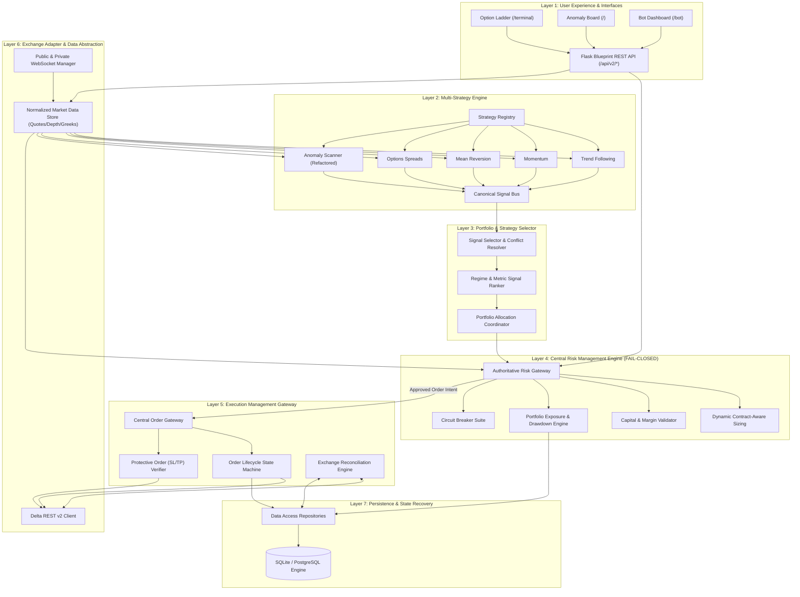

---

## 5. Complete Phase-by-Phase Implementation Roadmap (Phases 0 through 16)

```mermaid
gantt
    title Delta India Terminal Master Implementation Timeline
    dateFormat  YYYY-MM-DD
    section Baseline & Security
    Phase 0: Audit & Baseline          :done,    p0, 2026-11-12, 1d
    Phase 1: Stabilization & Fixes     :active,  p1, after p0, 2d
    Phase 2: Security & Isolation      :         p2, after p1, 2d
    section Core Infrastructure
    Phase 3: Persistence & Recovery    :         p3, after p2, 3d
    Phase 4: Exchange & Market Data    :         p4, after p3, 4d
    Phase 5: Analytics & Greeks        :         p5, after p4, 3d
    section Strategy & Risk
    Phase 6: Strategy Framework        :         p6, after p5, 2d
    Phase 7: Multi-Strategy Engine     :         p7, after p6, 4d
    Phase 8: Selector & Portfolio      :         p8, after p7, 2d
    Phase 9: Central Risk Gateway      :         p9, after p8, 4d
    Phase 10: Execution Engine         :         p10, after p9, 4d
    section Simulation & Validation
    Phase 11: Historical Backtesting   :         p11, after p10, 4d
    Phase 12: Paper Broker Simulator   :         p12, after p11, 3d
    Phase 13: Dashboard Upgrade        :         p13, after p12, 3d
    Phase 14: Testnet Validation       :         p14, after p13, 3d
    section Production Readiness
    Phase 15: Operational Readiness    :         p15, after p14, 2d
    Phase 16: Controlled Live Auto     :         p16, after p15, 3d
```

---

## 6. Detailed Subphase and Task Breakdown

### Phase 0: Repository Audit and Technical Baseline
- **Task 0.1 (TASK-P0-01): Source File Inventory & AST Validation**  
  *Detail:* Scan all `.py`, `.html`, `.js` files using Python's `ast` parser to confirm compilation and detect broken global imports.  
  *Files:* `app.py`, `scanners/options_scanner.py`.  
  *Deliverables:* Detailed verification report.
- **Task 0.2 (TASK-P0-02): Git Baseline Branching & Protection**  
  *Detail:* Establish `master` as production-protected; branch `develop` as integration trunk.  
  *Deliverables:* Git branch configuration.

### Phase 1: Stabilization and Existing Feature Protection
- **Task 1.1 (TASK-P1-01): Resolve `datetime` Collision**  
  *Detail:* Standardize datetime imports in `app.py` line 4 and line 430; replace `datetime.datetime.now()` with `datetime.now()`.  
  *Files:* `app.py`.  
  *Test:* Call `/api/scan` via pytest test client; expect HTTP 200 without exception.
- **Task 1.2 (TASK-P1-02): Implement Missing `DeltaAPI` Methods**  
  *Detail:* Add `get_ticker(symbol)` and `get_options_chain(symbol)` to `DeltaAPI` in `scanners/options_scanner.py`. Route requests through `_delta_public` or direct `/v2/tickers/{symbol}`.  
  *Files:* `scanners/options_scanner.py`, `app.py`.  
  *Test:* Query `/api/terminal?symbol=BTC&type=ticker` and `type=chain`.
- **Task 1.3 (TASK-P1-03): Fix Password Rotation Scope**  
  *Detail:* Initialize `TERMINAL_PASSWORD` correctly from `get_terminal_password()` in `app.py` before route evaluation.  
  *Files:* `app.py`.
- **Task 1.4 (TASK-P1-04): Pytest Harness & Regression Baseline**  
  *Detail:* Install `pytest`, `pytest-mock`. Write `tests/test_baseline.py` covering login throttle, proxy SSRF whitelist, HMAC signature calculation, and order validation.  
  *Files:* `requirements.txt`, `tests/test_baseline.py`.

### Phase 2: Security and Environment Isolation
- **Task 2.1 (TASK-P2-01): Explicit Environment Isolation Model**  
  *Detail:* Introduce configuration schema defining `TRADING_ENVIRONMENT` as strictly one of `['BACKTEST', 'PAPER', 'TESTNET', 'LIVE_MANUAL', 'LIVE_AUTO']`. Block any live URL when in testnet/paper mode.  
  *Files:* `config/settings.py`, `config/environments.py`.
- **Task 2.2 (TASK-P2-02): Multi-Account Credential Partitioning**  
  *Detail:* Refactor account loading in `app.py` into `config/accounts.py`. Require explicit `environment: 'testnet' | 'live'` metadata per account. Remove fuzzy fallback `aid == '2'`.  
  *Files:* `config/accounts.py`, `app.py`.
- **Task 2.3 (TASK-P2-03): Secret Redaction in Logs & JSON Responses**  
  *Detail:* Implement custom logging filter `SecretRedactionFilter` scrubbing API keys, secrets, and auth tokens from logs.  
  *Files:* `core/logging_config.py`.

### Phase 3: Persistent Storage and Recovery
- **Task 3.1 (TASK-P3-01): Database Engine & Session Factory**  
  *Detail:* Implement SQLAlchemy 2.0 / raw SQLite connection pool with WAL mode (`PRAGMA journal_mode=WAL; PRAGMA synchronous=NORMAL;`).  
  *Files:* `storage/database.py`.
- **Task 3.2 (TASK-P3-02): Schema & Entity Modeling**  
  *Detail:* Create relational tables: `accounts`, `instruments`, `signals`, `orders`, `fills`, `positions`, `risk_decisions`, `pnl_snapshots`, `circuit_breaker_events`.  
  *Files:* `storage/models.py`.
- **Task 3.3 (TASK-P3-03): State Rehydration upon Startup**  
  *Detail:* Write `storage/recovery.py` to restore open positions and active order states upon server restart.  
  *Files:* `storage/recovery.py`.

### Phase 4: Exchange Integration and Market-Data Foundation
- **Task 4.1 (TASK-P4-01): Modular Delta REST Adapter**  
  *Detail:* Extract `_delta_private` and `_delta_public` from `app.py` into a robust `DeltaRestClient` supporting rate-limiting (token bucket, 429 backoff) and timeout handling.  
  *Files:* `exchange/delta_client.py`.
- **Task 4.2 (TASK-P4-02): Public & Private WebSocket Gateway**  
  *Detail:* Implement multi-threaded WebSocket listener for channels: `v2/ticker`, `l2orderbook`, `orders`, `positions`. Maintain in-memory thread-safe local L2 book with sequence validation.  
  *Files:* `exchange/websocket_manager.py`.
- **Task 4.3 (TASK-P4-03): Market Data Normalization Layer**  
  *Detail:* Standardize futures and options market ticks into immutable `MarketDataQuote` dataclass with freshness timestamps. Reject quotes older than 3000ms.  
  *Files:* `exchange/market_data.py`.

### Phase 5: Analytics and Market Intelligence
- **Task 5.1 (TASK-P5-01): Black-Scholes Greeks Engine**  
  *Detail:* Implement analytical pricing and Greek calculation ($\Delta, \Gamma, \Theta, \mathcal{V}, \rho$) with continuous dividend yield for crypto options.  
  *Files:* `analytics/greeks.py`.
- **Task 5.2 (TASK-P5-02): Implied Volatility Surface & Skew Engine**  
  *Detail:* Implement Newton-Raphson / Brent root-finding to extract IV from market mid-prices. Construct 2D strike vs. expiry volatility grid.  
  *Files:* `analytics/implied_volatility.py`.
- **Task 5.3 (TASK-P5-03): Technical Indicators Engine**  
  *Detail:* Vectorized implementations of EMA, RSI, ATR, Bollinger Bands, and VWAP with multi-timeframe aggregation.  
  *Files:* `analytics/indicators.py`.
- **Task 5.4 (TASK-P5-04): Deterministic Market-Regime Classifier**  
  *Detail:* Regime detection categorizing market into: `TRENDING_BULL`, `TRENDING_BEAR`, `RANGING_LOW_VOL`, `RANGING_HIGH_VOL`, `BREAKOUT_EXPANSION`.  
  *Files:* `analytics/market_regime.py`.

### Phase 6: Standardized Strategy Framework
- **Task 6.1 (TASK-P6-01): Canonical `TradeSignal` Data Contract**  
  *Detail:* Define strict dataclass for trade signals prohibiting strategies from touching execution handles.  
  *Files:* `trading/signal.py`.
- **Task 6.2 (TASK-P6-02): Strategy Base Interface & Registry**  
  *Detail:* Implement abstract base class `BaseStrategy` with hooks `on_quote()`, `on_candle()`, `generate_signals()`. Build `StrategyRegistry`.  
  *Files:* `strategies/base.py`, `strategies/registry.py`.

### Phase 7: Multi-Strategy Development
- **Task 7.1 (TASK-P7-01): Refactor Anomaly Scanner into Strategy F**  
  *Detail:* Adapt `scanners/options_scanner.py` into `AnomalyStrategy`. Replace raw HTML text output with structured multi-leg `TradeSignal` objects.  
  *Files:* `strategies/anomaly_strategy.py`.
- **Task 7.2 (TASK-P7-02): Trend-Following Strategy (Strategy A)**  
  *Detail:* EMA 20/50 cross with ATR volatility channel confirmation on BTC/ETH futures.  
  *Files:* `strategies/trend_following.py`.
- **Task 7.3 (TASK-P7-03): Momentum Strategy (Strategy B)**  
  *Detail:* RSI momentum burst with volume acceleration filter.  
  *Files:* `strategies/momentum.py`.
- **Task 7.4 (TASK-P7-04): Mean Reversion Strategy (Strategy C)**  
  *Detail:* Bollinger Band 2.5$\sigma$ overshoot with RSI divergence on ranging regime.  
  *Files:* `strategies/mean_reversion.py`.
- **Task 7.5 (TASK-P7-05): Defined-Risk Options Spreads (Strategy E)**  
  *Detail:* Bull call and bear put vertical debit spreads with verified risk-to-reward ratio $> 1.5$.  
  *Files:* `strategies/options_spreads.py`.

### Phase 8: Strategy Selection and Portfolio Coordination
- **Task 8.1 (TASK-P8-01): Signal Deduplication and Freshness Filter**  
  *Detail:* Filter out signals with age $> 5000\text{ms}$ or matching active orders/positions.  
  *Files:* `trading/selector.py`.
- **Task 8.2 (TASK-P8-02): Cross-Strategy Conflict Detection**  
  *Detail:* Detect opposite directional signals (e.g., Trend Long vs. Mean Reversion Short on BTCUSD) and suppress both or defer to higher-timeframe regime.  
  *Files:* `trading/conflict_resolver.py`.
- **Task 8.3 (TASK-P8-03): Multi-Factor Signal Ranking**  
  *Detail:* Rank opportunities by reward/risk, current regime alignment, book liquidity, and execution cost.  
  *Files:* `trading/ranker.py`.

### Phase 9: Centralized Risk Management
- **Task 9.1 (TASK-P9-01): Real-Time P&L & Drawdown Tracking Engine**  
  *Detail:* Continuously compute Realized P&L from Delta fills and Unrealized P&L from mark prices. Persist daily equity baseline.  
  *Files:* `risk/pnl_tracker.py`.
- **Task 9.2 (TASK-P9-02): Contract-Aware Position Sizing Engine**  
  *Detail:* Calculate lot quantity using instrument specifications: `contract_value`, `lot_size`, `tick_size`, leverage limit, and stop-loss distance.  
  *Files:* `risk/position_sizing.py`.
- **Task 9.3 (TASK-P9-03): Fail-Closed Central Risk Gateway**  
  *Detail:* 11-step verification pipeline for all orders. If any check fails, emit `RiskDecision(approved=False, reason=...)`.  
  *Files:* `risk/risk_manager.py`.
- **Task 9.4 (TASK-P9-04): Hardware & Market Circuit Breakers**  
  *Detail:* Automatic halts for: daily loss breach ($> 2\%$), exchange heartbeat timeout ($> 10\text{s}$), or 3 consecutive order rejections.  
  *Files:* `risk/circuit_breaker.py`.

### Phase 10: Order Execution and Position Management
- **Task 10.1 (TASK-P10-01): Authoritative Execution Gateway**  
  *Detail:* Route all approved orders through `ExecutionManager`. Enforce client order ID idempotency.  
  *Files:* `trading/execution_manager.py`.
- **Task 10.2 (TASK-P10-02): Order Lifecycle State Machine**  
  *Detail:* Transition states: `CREATED` $\rightarrow$ `VALIDATED` $\rightarrow$ `RISK_APPROVED` $\rightarrow$ `SUBMITTED` $\rightarrow$ `ACKNOWLEDGED` $\rightarrow$ `PARTIALLY_FILLED` $\rightarrow$ `FILLED` (or `REJECTED`, `CANCELLED`).  
  *Files:* `trading/order_state.py`.
- **Task 10.3 (TASK-P10-03): Protective Bracket Order Verification**  
  *Detail:* Submit entry order; verify execution fill; immediately confirm native exchange stop-loss and take-profit brackets.  
  *Files:* `trading/bracket_manager.py`.
- **Task 10.4 (TASK-P10-04): Periodic Exchange State Reconciliation**  
  *Detail:* Run 15-second reconciliation job comparing local order/position tables against Delta API `/v2/positions/margined` and `/v2/orders`. Flag any mismatch as `RECONCILIATION_REQUIRED`.  
  *Files:* `trading/reconciliation.py`.

### Phase 11: Historical Backtesting
- **Task 11.1 (TASK-P11-01): Historical Data Ingestion & Storage**  
  *Detail:* Download and normalize 1m/5m/1h historical candles and trade tick logs for BTC/ETH futures and options.  
  *Files:* `simulation/data_loader.py`.
- **Task 11.2 (TASK-P11-02): Event-Driven Backtesting Engine**  
  *Detail:* Bar-by-bar, tick-by-tick simulation without look-ahead bias. Incorporate Delta fee schedule (taker 0.05%, maker 0.02%) and slippage models.  
  *Files:* `simulation/backtester.py`.
- **Task 11.3 (TASK-P11-03): Performance & Metrics Analytics**  
  *Detail:* Compute CAGR, Sharpe ratio, Sortino ratio, Max Drawdown duration, Profit Factor, and win/loss payoff ratio.  
  *Files:* `simulation/performance.py`.

### Phase 12: Paper Trading Simulator
- **Task 12.1 (TASK-P12-01): Simulated Paper Broker**  
  *Detail:* Implements identical interface as `DeltaRestClient` but executes against live order book without placing exchange orders.  
  *Files:* `simulation/paper_broker.py`.
- **Task 12.2 (TASK-P12-02): Virtual Ledger & Paper Positions**  
  *Detail:* Maintain dedicated SQLite tables `paper_orders`, `paper_positions`, `paper_ledger`.  
  *Files:* `simulation/paper_ledger.py`.

### Phase 13: Dashboard and User Experience
- **Task 13.1 (TASK-P13-01): Unified System Health & Mode Banner**  
  *Detail:* Persistent top banner displaying: Active Mode (`PAPER`/`TESTNET`/`LIVE`), Heartbeat Latency, Realized P&L, Daily Loss Limit remaining, and Emergency Stop button.  
  *Files:* `templates/layout.html`, `static/js/health_monitor.js`.
- **Task 13.2 (TASK-P13-02): Risk & Circuit Breaker Status UI**  
  *Detail:* Visual meters for margin utilization, per-strategy exposure, and active circuit breakers.  
  *Files:* `templates/bot_dashboard.html`, `static/js/risk_ui.js`.
- **Task 13.3 (TASK-P13-03): Strategy Manager & Signal History Table**  
  *Detail:* Enable/disable toggles per strategy, live signal feed, and execution latency logs.  
  *Files:* `templates/strategy_dashboard.html`.

### Phase 14: Testnet Validation
- **Task 14.1 (TASK-P14-01): End-to-End Testnet Execution Suite**  
  *Detail:* Automated script executing testnet futures order, testnet option order, amend order, bracket trigger, and cancel-all.  
  *Files:* `tests/testnet/test_e2e_orders.py`.
- **Task 14.2 (TASK-P14-02): Failure Injection Verification**  
  *Detail:* Simulate network drop during open order, simulate exchange 429 response, simulate server crash mid-trade, and verify zero duplicate orders.  
  *Files:* `tests/testnet/test_fault_recovery.py`.

### Phase 15: Deployment and Operational Readiness
- **Task 15.1 (TASK-P15-01): Process Supervision & Healthchecks**  
  *Detail:* Service manager script (Systemd / Windows Task Scheduler / Dockerfile) ensuring automated recovery upon crash.  
  *Files:* `deploy/supervisord.conf` or `deploy/service.ps1`.
- **Task 15.2 (TASK-P15-02): Automated Database Backup Procedure**  
  *Detail:* Hourly SQLite `.backup` snapshots with 7-day rolling retention.  
  *Files:* `scripts/backup_db.py`.

### Phase 16: Controlled Live Automation
- **Task 16.1 (TASK-P16-01): Live Readiness Checklist Verification**  
  *Detail:* Multi-point cryptographic and operational sign-off before unmasking `LIVE_AUTO`.  
  *Files:* `scripts/verify_live_readiness.py`.
- **Task 16.2 (TASK-P16-02): Phased Capital Rollout Configuration**  
  *Detail:* Restrict initial live trading to single micro-lot contract on Strategy A/F with hard stop at \$20 loss.  
  *Files:* `config/live_rollout.py`.

---

## 7. Task Dependency Graph

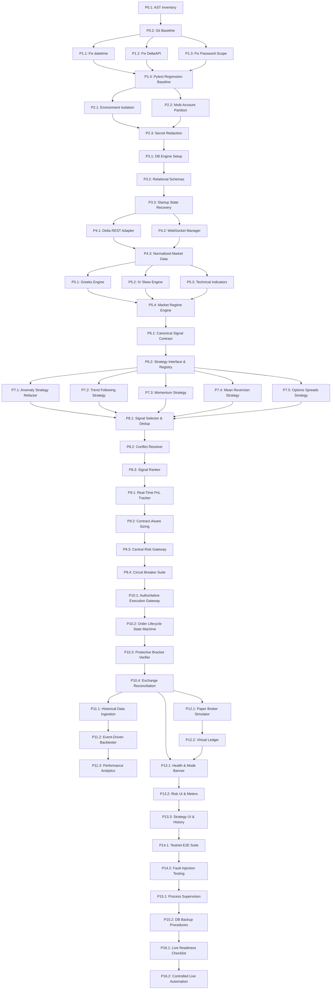

---

## 8. Target Repository Structure

```
delta-v01/
├── app.py                         # Clean Flask entrypoint & route registration
├── config/
│   ├── __init__.py
│   ├── settings.py                # Pydantic/dataclass validated configuration
│   ├── environments.py            # BACKTEST, PAPER, TESTNET, LIVE_MANUAL, LIVE_AUTO definitions
│   └── accounts.py                # Multi-account metadata, environments, and credentials
├── core/
│   ├── __init__.py
│   ├── logging_config.py          # Structured JSON logging & secret redaction
│   └── exceptions.py              # Root domain exceptions (RiskViolation, ExchangeError)
├── storage/
│   ├── __init__.py
│   ├── database.py                # Connection pool, engine, session factory (WAL mode)
│   ├── models.py                  # SQLAlchemy declarative schemas
│   ├── recovery.py                # Post-restart rehydration & state restoration
│   └── repositories/
│       ├── order_repo.py
│       ├── position_repo.py
│       └── pnl_repo.py
├── exchange/
│   ├── __init__.py
│   ├── delta_client.py            # Robust signed REST API client (rate-limits, retries)
│   ├── websocket_manager.py       # Public/private WS feeds, heartbeat, reconnect
│   ├── market_data.py             # Quote normalizer, L2 orderbook, freshness filter
│   └── account_sync.py            # Account balance and position polling
├── analytics/
│   ├── __init__.py
│   ├── greeks.py                  # Black-Scholes analytical Greeks
│   ├── implied_volatility.py      # Newton-Raphson IV solver
│   ├── indicators.py              # EMA, RSI, ATR, VWAP
│   └── market_regime.py           # Multi-factor regime classifier
├── strategies/
│   ├── __init__.py
│   ├── base.py                    # BaseStrategy ABC
│   ├── registry.py                # Dynamic strategy discovery and lifecycle
│   ├── trend_following.py         # Strategy A: Futures trend continuation
│   ├── momentum.py                # Strategy B: Futures momentum burst
│   ├── mean_reversion.py          # Strategy C: Statistical mean reversion
│   ├── options_spreads.py         # Strategy E: Vertical debit/credit spreads
│   └── anomaly_strategy.py        # Strategy F: Refactored options anomaly scanner
├── trading/
│   ├── __init__.py
│   ├── signal.py                  # Canonical TradeSignal dataclass
│   ├── selector.py                # Signal deduplication & regime filter
│   ├── conflict_resolver.py       # Inter-strategy conflict detection
│   ├── ranker.py                  # Signal scoring and ranking
│   ├── execution_manager.py       # Authoritative order gateway
│   ├── order_state.py             # State machine (CREATED -> FILLED/REJECTED)
│   ├── bracket_manager.py         # SL/TP placement and confirmation
│   └── reconciliation.py          # Exchange state auditor
├── risk/
│   ├── __init__.py
│   ├── risk_manager.py            # Fail-closed central risk validation gate
│   ├── position_sizing.py         # Contract-aware sizing & margin validator
│   ├── pnl_tracker.py             # Realized + Unrealized P&L calculator
│   ├── portfolio_risk.py          # Exposure caps, correlation checks
│   └── circuit_breaker.py         # Emergency stops & hardware cutoffs
├── simulation/
│   ├── __init__.py
│   ├── backtester.py              # Event-driven backtesting engine
│   ├── paper_broker.py            # Paper broker matching against live L2 book
│   ├── data_loader.py             # Historical candle/tick loader
│   └── performance.py             # Sharpe, Sortino, Drawdown analytics
├── templates/                     # Preserved & upgraded Jinja2 templates
│   ├── terminal.html
│   ├── index.html
│   ├── bot_dashboard.html
│   └── login.html
├── static/
│   ├── js/
│   └── css/
├── tests/
│   ├── test_baseline.py
│   ├── test_risk.py
│   ├── test_sizing.py
│   ├── test_execution.py
│   ├── test_greeks.py
│   └── testnet/
├── migrations/
├── requirements.txt
├── IMPLEMENTATION_PLAN.md
└── README.md
```

### Module Call Graph Governance
- **Rule 1:** `strategies/*` may only read from `analytics/*` and `exchange/market_data.py`. They emit `TradeSignal` objects to `trading/signal.py`. Strategies **MUST NEVER** import `exchange/delta_client.py` or `trading/execution_manager.py`.
- **Rule 2:** `trading/execution_manager.py` may only accept orders that carry a cryptographically signed or verifiable `RiskDecision(approved=True)` from `risk/risk_manager.py`.
- **Rule 3:** All database writes must go through `storage/repositories/*`.

---

## 9. Database Schema (SQLite / PostgreSQL Compatible)

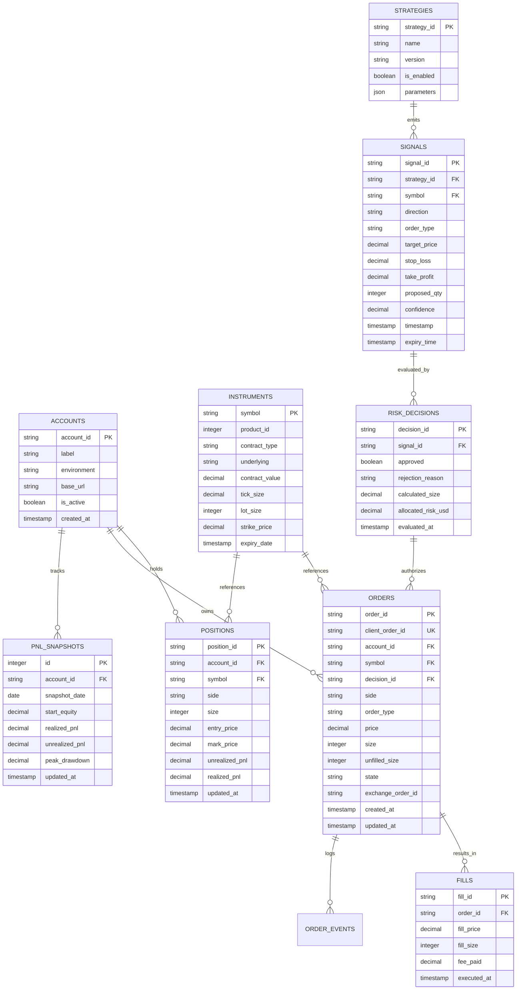

---

## 10. Internal API Design

| Endpoint | Method | Auth Required | Triggers Exchange Order? | Description |
|---|---|---|---|---|
| `/api/v2/system/mode` | GET | Yes | No | Returns active mode (`PAPER`/`TESTNET`/`LIVE`) and health. |
| `/api/v2/system/emergency-stop` | POST | Yes | **YES (Cancel All)** | Halts scanning, trips circuit breaker, cancels all active orders. |
| `/api/v2/market/quote` | GET | Yes | No | Returns normalized L1 quote, L2 depth snippet, and Greeks. |
| `/api/v2/strategies` | GET | Yes | No | Lists registered strategies, versions, and current status. |
| `/api/v2/strategies/control` | POST | Yes | No | Enables or disables an individual strategy. |
| `/api/v2/risk/metrics` | GET | Yes | No | Real-time daily P&L, drawdown %, per-strategy exposure. |
| `/api/v2/orders/place` | POST | Yes | **YES (If Risk Passes)** | Standard order entry: routed to Risk Gateway $\rightarrow$ Execution Gateway. |
| `/api/v2/orders/amend` | POST | Yes | **YES** | Atomic native PUT amendment. |
| `/api/v2/orders/cancel` | POST | Yes | **YES** | Cancels specific order ID. |
| `/api/v2/orders/active` | GET | Yes | No | Retrieves open orders across accounts from DB + exchange. |
| `/api/v2/positions` | GET | Yes | No | Net open positions with mark prices and unrealized P&L. |

---

## 11. Market-Data Architecture & Quote Validation

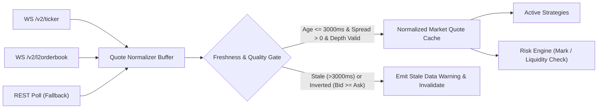

### Validation Formulas
1. **Spread Sanity:** $\text{Ask} > \text{Bid} > 0$
2. **Quote Freshness:** $T_{\text{local}} - T_{\text{exchange}} \le 3000\text{ ms}$
3. **Liquidity Depth Check:** $\sum_{i=1}^3 \text{BidSize}_i \ge \text{MinLotSize} \quad \text{and} \quad \sum_{i=1}^3 \text{AskSize}_i \ge \text{MinLotSize}$

---

## 12. Strategy Framework & Standardized Signal Contract

### Standard Signal Contract (Dataclass)
```python
from dataclasses import dataclass, field
from datetime import datetime
from typing import Optional, Dict, Any, List

@dataclass(frozen=True)
class TradeSignal:
    signal_id: str                      # UUID4
    strategy_id: str                    # e.g. "trend_following_btc"
    strategy_version: str               # e.g. "1.2.0"
    symbol: str                         # e.g. "BTCUSD" or "C-BTC-70000-270926"
    direction: str                      # "BUY" or "SELL"
    order_type: str                     # "limit_order" or "market_order"
    target_entry_price: float
    stop_loss_price: float
    take_profit_price: float
    proposed_size: Optional[int]        # Strategy recommendation (subject to Risk Gate)
    max_slippage_pct: float             # e.g. 0.005 (0.5%)
    expected_holding_period_sec: int
    timestamp: datetime
    expiry_time: datetime               # Discard signal if not filled by this time
    confidence: float                   # 0.0 to 1.0 (statistical score)
    rationale: Dict[str, Any]           # Supporting indicator values
    legs: Optional[List[Dict[str, Any]]] = None  # Multi-leg option definition
```

---

## 13. Central Risk Management Design

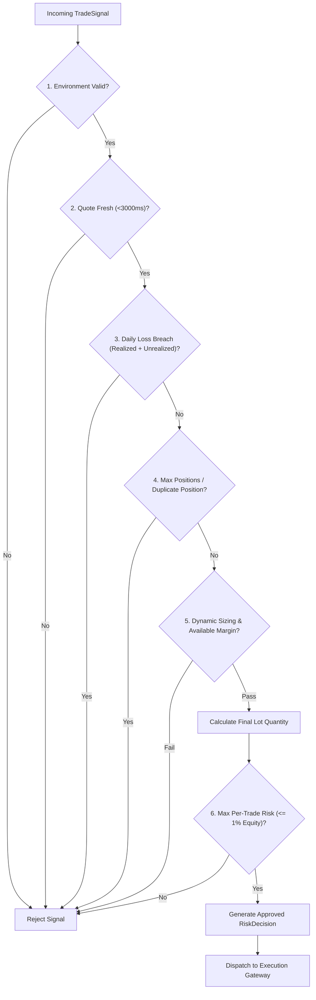

### Mathematical Position Sizing Formula
$$\text{MaxRiskUSD} = \text{AccountEquity} \times \text{RiskPctPerTrade}$$
$$\text{UnitLossUSD} = |\text{EntryPrice} - \text{StopLossPrice}| \times \text{ContractMultiplier}$$
$$\text{Size}_{\text{risk}} = \left\lfloor \frac{\text{MaxRiskUSD}}{\text{UnitLossUSD} + (\text{EntryPrice} \times \text{FeeRate} \times \text{ContractMultiplier})} \right\rfloor$$
$$\text{Size}_{\text{margin}} = \left\lfloor \frac{\text{AvailableMargin} \times \text{MaxMarginPct}}{\text{InitialMarginPerContract}} \right\rfloor$$
$$\text{FinalSize} = \max\left(0, \; \min(\text{Size}_{\text{risk}}, \; \text{Size}_{\text{margin}}, \; \text{MaxAllowedLots})\right)$$

---

## 14. Execution Engine Design & Lifecycle State Machine

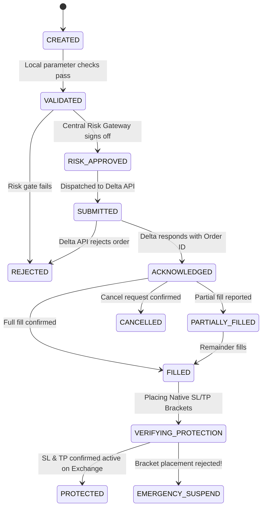

---

## 15. Backtesting Architecture

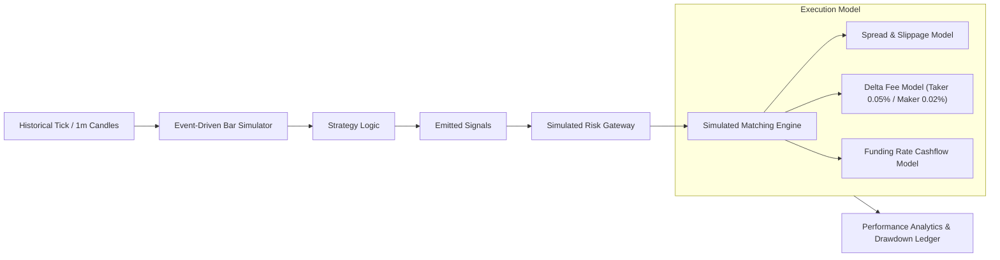

---

## 16. Paper Trading Simulator

The **Paper Broker (`simulation/paper_broker.py`)** exposes the exact same method signatures as `DeltaRestClient`:
- `place_order(symbol, side, size, price, type, brackets)`
- `cancel_order(order_id)`
- `get_open_orders()`
- `get_positions()`

It matches orders against the **live L2 order book** obtained from the WebSocket feed:
- Limit buy fills when live `best_ask <= limit_price`.
- Stop loss triggers when live `mark_price <= sl_price`.
- Fees and slippage are deducted from a virtual paper balance ledger stored in SQLite.

---

## 17. Dashboard Upgrade Plan

The existing Flask UI will be enhanced incrementally without breaking familiar hotkeys or views:

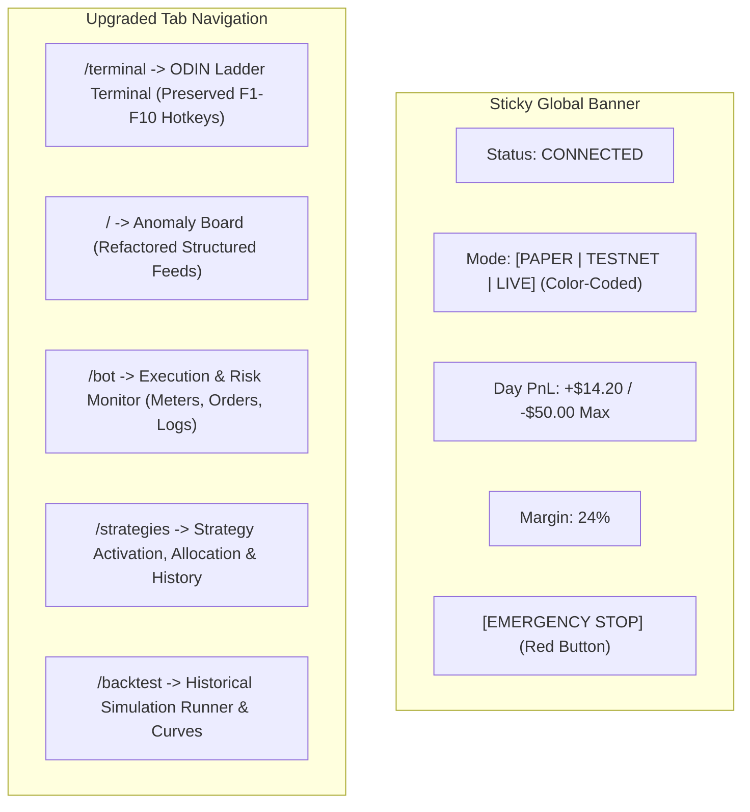

---

## 18. Security Architecture & Threat Model

| Threat | Vulnerability Path | Mitigation in Target Architecture |
|---|---|---|
| **Accidental Live Execution** | Misconfigured `.env` or account index (`aid == 2`) | Hard-coded environment flag; separate API credential vaults; explicit `LIVE_AUTO_AUTHORIZED=true` check. |
| **SSRF via Proxy** | Unrestricted `/delta?url=...` | Whitelist strictly pinned to `api.india.delta.exchange`, `cdn-ind.testnet.deltaex.org`. Schema pinned to HTTPS. |
| **Credential Leakage** | API secret printed in stack traces or logs | `SecretRedactionFilter` scrubs all keys matching regex `[a-zA-Z0-9]{32,}` from all log streams. |
| **Brute Force Terminal Access** | Password guessing on `/login` | IP-based rate limiting (5 attempts $\rightarrow$ 300s lock); SHA-256 token validation with `hmac.compare_digest`. |
| **Double Order on API Timeout** | Blind retry on HTTP 504 Gateway Timeout | Unique `client_order_id` (UUID); query `/v2/orders` state *before* retrying any submission. |

---

## 19. Testing and Quality Assurance Strategy

```mermaid
flowchart TD
    T_UNIT["Unit Tests (Fast, In-Memory)"]
    T_INT["Integration Tests (Mocked Exchange)"]
    T_FAULT["Fault Injection Tests (Timeouts, Desync)"]
    T_NET["Testnet E2E Tests (Live Testnet API)"]
    
    T_UNIT --> M1["Greeks & Math formulas"]
    T_UNIT --> M2["Position sizing bounds"]
    T_UNIT --> M3["Signal validation rules"]
    
    T_INT --> I1["REST adapter retries & auth"]
    T_INT --> I2["SQLite state persistence & rehydration"]
    T_INT --> I3["Order lifecycle state transitions"]
    
    T_FAULT --> F1["Simulated 429 Rate Limit"]
    T_FAULT --> F2["Worker thread crash recovery"]
    T_FAULT --> F3["Desync between local DB and exchange"]
    
    T_NET --> N1["Real limit order & atomic amend"]
    T_NET --> N2["Native bracket execution"]
    T_NET --> N3["Cancel all double-confirmation"]
```

---

## 20. Deployment and Recovery Plan

1. **Host Environment:** Windows local host / Linux workstation.
2. **Process Management:** Running via systemd service or Windows PowerShell watchdog script ensuring automatic restart upon unhandled crashes.
3. **Graceful Shutdown:** `SIGTERM` / `SIGINT` handler halts scanner loop, clears active thread pools, flushes SQLite WAL buffers, and preserves open order state.
4. **Disaster Recovery:** Hourly automated SQLite snapshot to `backups/delta_terminal_YYYYMMDD_HH.db`.

---

## 21. Git & Claude Code Workflow

To guarantee zero regressions and complete traceability, future development sessions with Claude Code must follow this strict 12-step protocol:

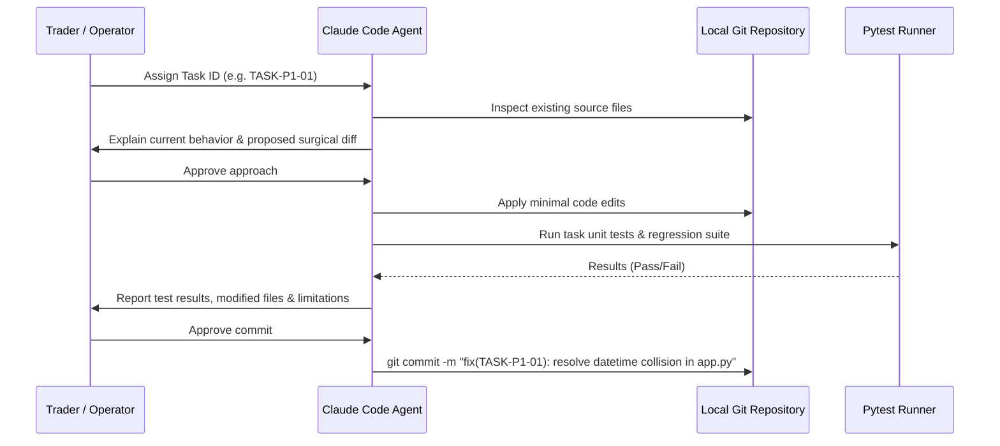

---

## 22. Estimated Engineering Effort

*Assumptions:* Experienced quant/Python engineer; 1 day = 6–8 focused engineering hours.

| Phase | Description | Priority | Est. Effort (Days) |
|---|---|---|---|
| **Phase 0** | Repository Audit and Baseline | P0 | 1.0 |
| **Phase 1** | Stabilization and Crash Fixes | P0 | 2.0 |
| **Phase 2** | Security and Environment Isolation | P0 | 2.0 |
| **Phase 3** | Persistent Storage and Recovery | P1 | 3.0 |
| **Phase 4** | Exchange & Market Data Layer | P1 | 4.0 |
| **Phase 5** | Analytics, Greeks & Regime Detection | P2 | 3.0 |
| **Phase 6** | Standardized Strategy Framework | P1 | 2.0 |
| **Phase 7** | Multi-Strategy Development | P2 | 4.0 |
| **Phase 8** | Strategy Selection & Portfolio Coordination | P2 | 2.0 |
| **Phase 9** | Centralized Risk Management Engine | P0 | 4.0 |
| **Phase 10** | Order Execution & Bracket Management | P0 | 4.0 |
| **Phase 11** | Historical Backtesting Engine | P3 | 4.0 |
| **Phase 12** | Paper Trading Simulator | P1 | 3.0 |
| **Phase 13** | Dashboard & UX Upgrades | P2 | 3.0 |
| **Phase 14** | Testnet End-to-End Validation | P1 | 3.0 |
| **Phase 15** | Deployment & Operational Readiness | P1 | 2.0 |
| **Phase 16** | Controlled Live Automation Release | P0 | 3.0 |
| **Total** | **Full System Implementation** | | **45.0 Days** |

---

## 23. Phase Completion Criteria

A phase is considered **COMPLETE** only when:
1. Every subtask has verified passing unit and integration tests.
2. Zero regressions exist in the existing ladder (`/terminal`) and anomaly scanner (`/`).
3. All database migrations are reversible and committed.
4. No sensitive secrets or credentials appear in test files, code, or logs.
5. The phase deliverable checklist is signed off.

---

## 24. Global Project Completion Checklist

- [ ] All 16 phases successfully implemented and tested.
- [ ] No raw strategy code can call exchange order placement endpoints.
- [ ] Daily P&L and drawdown limits persist across server restarts.
- [ ] Position sizing dynamically calculates contract multiplier and lot size.
- [ ] Delta native brackets (SL/TP) are verified active upon every fill.
- [ ] Real-time reconciliation detects any discrepancy between local DB and exchange.
- [ ] Paper trading matches live market data with realistic fees and zero exchange orders.
- [ ] Testnet validation passes all fault injection scenarios.
- [ ] Explicit user sign-off recorded before enabling `LIVE_AUTO`.

---

## 25. Open Decisions Requiring User Approval

Before code implementation begins, the user must approve the following architectural decisions:

1. **Storage Engine Default:**  
   *Recommendation:* **SQLite with WAL mode** for local single-process deployment, with SQLAlchemy models designed for frictionless PostgreSQL migration if multi-worker scaling is required later.
2. **Historical Data Sourcing:**  
   *Recommendation:* Use Delta REST `/v2/history/candles` for initial backtests; optionally augment with local Parquet flat files for multi-month tick resolution.
3. **Position Netting vs. Hedge Mode:**  
   *Recommendation:* Enforce **Netting Mode** initially (Delta standard) to prevent conflicting concurrent long/short positions on the same contract.
4. **Primary Testnet Validation Strategy:**  
   *Recommendation:* Require a mandatory **7-day zero-defect paper trading trial** followed by a **3-day testnet run** before unlocking live execution.

---

## 26. Execution Kick-Off: First 10 Concrete Development Tasks

When implementation commences, Claude Code will execute the following first 10 tasks in strict order:

1. **TASK-P1-01:** Fix `datetime.datetime` syntax collision in `app.py:430`.
2. **TASK-P1-02:** Add `get_ticker` and `get_options_chain` methods to `DeltaAPI` in `scanners/options_scanner.py`.
3. **TASK-P1-03:** Initialize global `TERMINAL_PASSWORD` scope in `app.py:1432`.
4. **TASK-P1-04:** Install `pytest`, `pytest-mock` and construct `tests/test_baseline.py`.
5. **TASK-P2-01:** Create `config/environments.py` with strict `TRADING_ENVIRONMENT` definitions.
6. **TASK-P2-02:** Eliminate naive `aid == '2'` fallback in `app.py`; mandate explicit account tags.
7. **TASK-P2-03:** Implement `SecretRedactionFilter` in logging configuration.
8. **TASK-P3-01:** Implement SQLite WAL connection pool and engine in `storage/database.py`.
9. **TASK-P3-02:** Define core declarative models (`orders`, `positions`, `pnl_snapshots`) in `storage/models.py`.
10. **TASK-P3-03:** Build post-restart state rehydration in `storage/recovery.py`.

